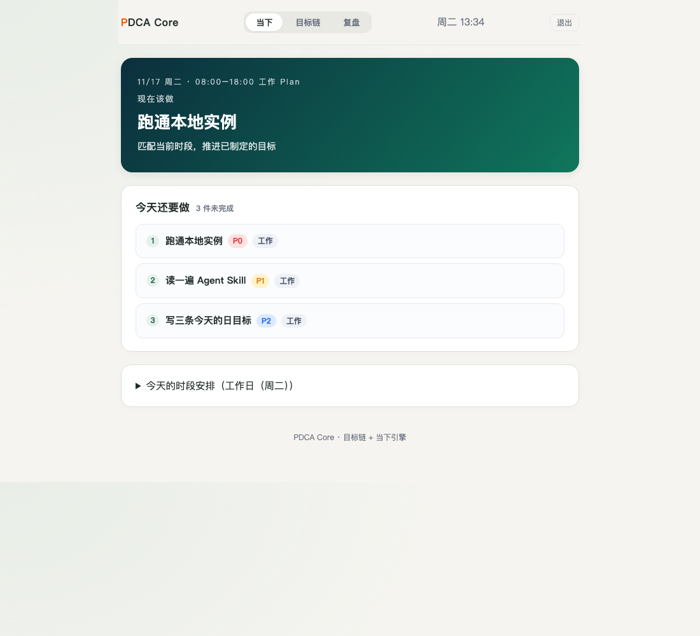
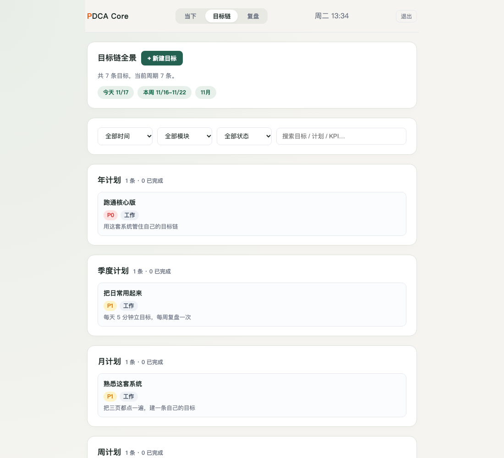
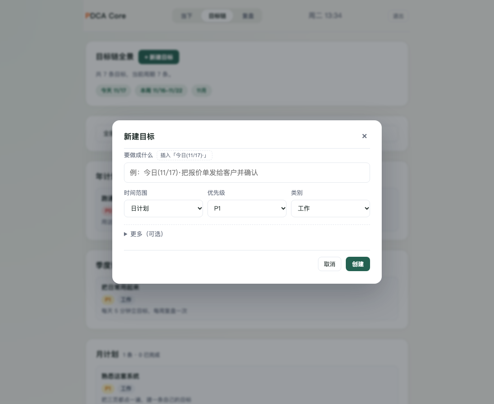
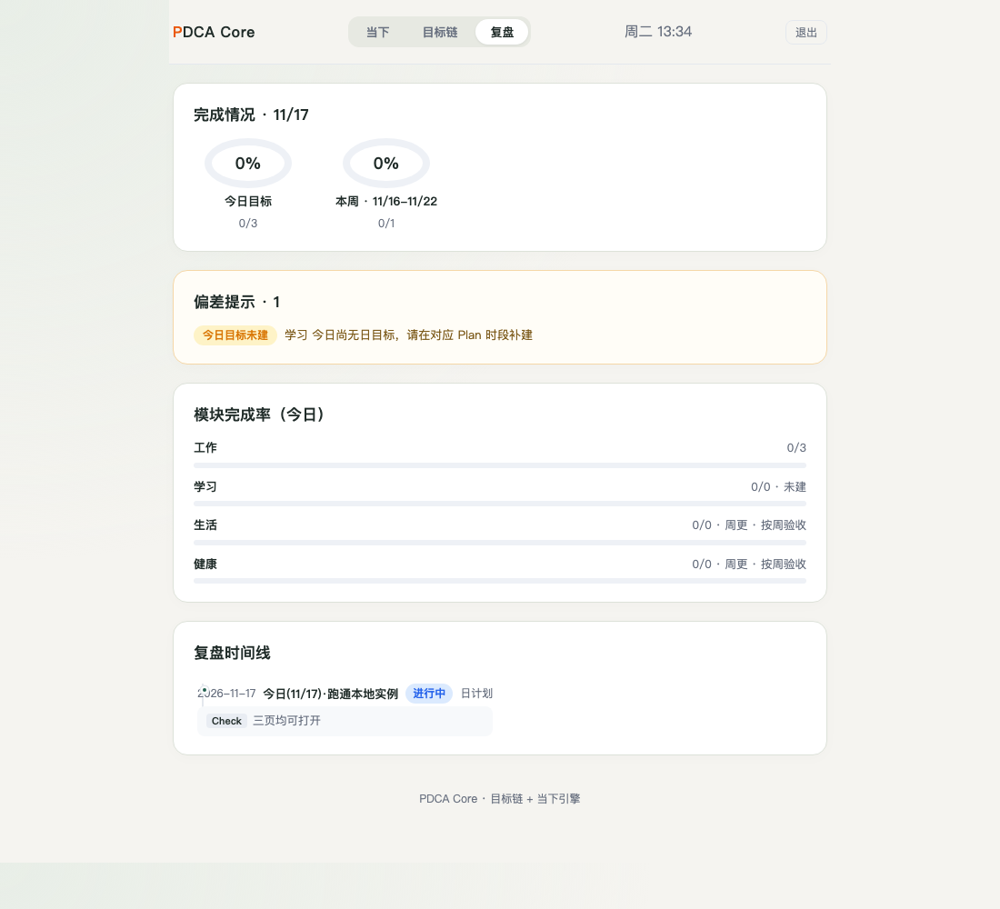

# PDCA Core

**An agent-first goal tracker.** You describe goals in plain language; an agent writes them through the API. The web app shows the chain, tells you what to do now, and keeps the review loop.

[中文](README.md) · English

[](https://github.com/lxj808624/pdca-core/actions/workflows/test.yml)
[](LICENSE)



## Run it in 30 seconds

Requires **Node.js ≥ 22.13** (the database uses built-in `node:sqlite`). `npm test` is a bash script; on Windows use WSL or Git Bash.

```bash
npm install && npm install --prefix client
npm run build
npm start            # http://localhost:3000
```

An empty database is created automatically. The first visit has two steps: choose one list or a few categories, then create the first goal.

Want sample data first?

```bash
npm run seed:demo
```

**A public deployment must set `PDCA_PASSCODE` + `PDCA_API_TOKEN`; without them, local development only.**

## What PDCA is

PDCA is **Plan → Do → Check → Act** on repeat: decide the goal and the approach, do the work, inspect the result, then keep what worked and adjust the next round. It is not about getting it right the first time; it is about making each round closer than the last.

This project puts the loop on a goal chain: Plan writes the goal and the approach, Do runs on the Now page, Check reads completion and deviations on the Review page, Act writes the conclusion back into the goal.

Further reading: [PDCA (Baidu Baike, Chinese)](https://baike.baidu.com/item/PDCA%E5%BE%AA%E7%8E%AF)

## What it is

- **Six-level goal chain**: 3-year → year → quarter → month → week → day, linked by `parent_id` and traceable upward.
- **Now engine**: combines the time block, status and priority to answer “what should I do now, what is still missing today”.
- **Hard validation**: active-goal limits, sub-lines, chain integrity and priority are enforced by the server, not by agent discipline.
- **Configurable worldview**: categories, pillars, horizons, schedule and rule strength live in `profile/`; swap the file and you have another system.
- **Agent onboarding**: `AGENTS.md` + `agent/skills/pdca/`, so any agent can pick up the workflow.

Good for: people who want an agent to manage goals over time without handing them to a SaaS.
Not for: multi-user collaboration, accounts, mobile push — none of that is built. No Docker.

<details>
<summary>Goal chain / new goal / review</summary>



Use “+ New goal” for the form (or `?new=1#plan`). Validation failures are shown at the top of the form.



</details>

## The three pages

| Page | URL | Content |
|---|---|---|
| Now | `/` | One hero saying “start here / do this now”, then today’s remaining goals; time blocks are collapsible at the bottom |
| Goals | `/#plan` | Goals grouped by horizon, filters and search, “+ New goal”, detail drawer (edit / status / delete) |
| Review | `/#check` | Today/week completion, deviations, completion by category (with categories), review timeline |

Two write paths, one database, one set of rules in `server/validate.js`:

- **Web form**: a signed-in same-origin Cookie session is enough (the server checks `Origin` for CSRF), no token to type.
- **Agent / script**: `Authorization: Bearer $PDCA_API_TOKEN` (read and write, no Cookie needed).

```bash
curl -s -X POST http://localhost:3000/api/goals \
  -H "Authorization: Bearer $PDCA_API_TOKEN" -H 'Content-Type: application/json' \
  -d '{"name":"今日(11/17)·Ship the core build","module":"工作","dimension":"日计划","priority":"P0"}'
```

Goal names need the period prefix (`2026年·` / `Q4·` / `11月：` / `本周(11/9-11/15)·` / `今日(11/17)·`), otherwise they do not enter the Now page. Full rules: `agent/skills/pdca/SKILL.md §4`.

These reserved strings stay Chinese on purpose: the engine parses the period prefix, and `dimension` / default `module` values come from the engine and `profile/default.json`. The UI shows them translated (Work / Day), but stored values keep the configured keys. You can set your own `modules` to English in a profile; `dimension` stays one of the engine’s fixed horizons.

## Language

The UI supports Chinese and English. It follows the browser language by default; the `中文 / EN` button in the top bar switches it and remembers the choice on this device. Server messages and the login page follow the same `Accept-Language` / cookie.

## Profile (`profile/`)

`profile/default.json` is a **sample**: four categories (Work / Learning / Life / Health) plus a normal schedule. To use your own:

```bash
cp profile/default.json profile/local.json     # local*.json is gitignored
# edit categories, pillars, horizons, rules and schedule in profile/local.json
PDCA_PROFILE=$PWD/profile/local.json npm start
```

Category source, highest first:

1. **`meta.modules`**: what the user picked in the first-run screen (one database per person; changing the profile does not overwrite it).
2. **`profile.modules`**: the defaults when the user has not picked.

So: change `profile/default.json` for everyone’s default; use `PDCA_PROFILE` pointing at `profile/local.json` for yourself.

After first run, change categories with `POST /api/setup {"modules":["Work","Side project"]}`; `[]` returns to one list. Changing it with existing goals makes old-category goals disappear from the list, so avoid it unless necessary.

Key rules (all adjustable in the profile):

- `rules.mainlineLimit`: maximum active goals per “category + sub-category + horizon + period” (default 3).
- `rules.subLineSplit`: when a category has `subLines`, the goal name must contain one of them.
- `modules[].cadence`: `daily` / `weekly` / `none` (time block only, no goals).
- `schedule`: the time-block table. To turn time blocks off entirely, use Goals → Settings (`POST /api/settings {"timeBlocks": false}`).

## Environment variables

| Variable | Default | Meaning |
|---|---|---|
| `PORT` | 3000 | Server port |
| `HOST` | 127.0.0.1 | Listen address; put Nginx in front |
| `PDCA_DB` | `data/pdca.db` | SQLite path |
| `PDCA_PROFILE` | `profile/default.json` | Worldview config, any absolute path |
| `PDCA_PASSCODE` | none | Browser passcode (30-day session Cookie) |
| `PDCA_API_TOKEN` | none | Bearer token for writes and script reads (or `server/config/api.json`) |
| `PDCA_SEED` | `data/seed.ndjson` | Import source for `npm run seed` |
| `PDCA_CALENDAR` | none | External holiday JSON (absolute path) for years not built in |

## Deploy to the public internet (systemd + Nginx + HTTPS)

```bash
git clone https://github.com/lxj808624/pdca-core.git /srv/pdca-core && cd /srv/pdca-core
npm install && npm install --prefix client && npm run build

cp deploy/pdca-core.service /etc/systemd/system/   # adjust ExecStart if `which node` is not /usr/bin/node
printf 'PORT=3000\nHOST=127.0.0.1\nPDCA_DB=/srv/pdca-core/data/pdca.db\nPDCA_PASSCODE=%s\nPDCA_API_TOKEN=%s\nTZ=Asia/Shanghai\n' \
  "$(openssl rand -hex 12)" "$(openssl rand -hex 16)" > /etc/pdca-core.env
chmod 600 /etc/pdca-core.env

systemctl daemon-reload && systemctl enable --now pdca-core

cp deploy/nginx-site.conf /etc/nginx/sites-available/pdca-core   # change domain and port
ln -sf /etc/nginx/sites-available/pdca-core /etc/nginx/sites-enabled/pdca-core
nginx -t && systemctl reload nginx
certbot --nginx -d <your-domain> --non-interactive --agree-tos -m <email>
```

Update: `bash deploy/deploy.sh` (`git pull` → install → build → restart → retry `/api/health` 20 times; `--seed` also imports the snapshot).

On Windows / macOS for local use, just `npm start` (data and port stay on the machine; do not expose it).

## Backup / restore

```bash
bash deploy/backup.sh                 # → backups/pdca-<time>.db + profile-<time>/ + goals-<time>.ndjson
# crontab: 10 3 * * * cd /srv/pdca-core && bash deploy/backup.sh >> /var/log/pdca-backup.log 2>&1

bash deploy/restore.sh backups/pdca-20261117-031000.db   # saves the current DB under backups/pre-restore-<time>/ first
```

Backup runs `PRAGMA wal_checkpoint(TRUNCATE)` first so a half-written WAL is not copied. The latest 10 copies are kept.

## Calendar

`server/calendar.js` includes the 2026 and 2027 holidays and make-up workdays. When the next year is published, add it there, or point `PDCA_CALENDAR` at a JSON file (format in the file header). Missing years fall back to weekend approximation.

## Checks and troubleshooting

```bash
npm test        # scripts/smoke.sh: temporary database, auth / modules / validation / Now / Review / backup
```

| Symptom | Cause / fix |
|---|---|
| Exits at startup, Node version message | Below 22.13 (or 23.0–23.3); upgrade to latest 22 LTS / 23.4+ / 24+ |
| Page 401 / keeps going to login | Not signed in or wrong passcode; use `/login`, or drop `PDCA_PASSCODE` for local work |
| Page write 401 | Cookie expired (sign in again); script writes need a Bearer token |
| Page write 403 | Cross-site request rejected (`Origin` does not match); operate from the site itself |
| Daily goal missing from Now | Name lacks the period prefix, or the category is outside the profile (read `/api/profile`) |
| Demo data not visible | Demo is generated for your categories; check first-run choice, or re-import with `?force=true` |
| “Frontend not built” | `npm start` without `npm run build` |

## Layout

```
server/      Fastify API + node:sqlite (engine: now.js / check.js / validate.js / usermodules.js)
client/      React app (three pages + detail drawer + goal form)
profile/     Worldview config (default.json is a sample; local*.json is yours, not committed)
agent/       Agent onboarding (AGENTS.md → skills/pdca/)
deploy/      systemd / Nginx / deploy / backup / restore
scripts/     Smoke tests (smoke.sh + smoke.mjs)
docs/        SCOPE (cut lines and milestones), TODO, screenshots
```

## Use it from an agent

This is the main design: **the human talks to an agent; the agent writes goals and reads the Now page through the API; the web app is the display and the manual fallback.**

Give any agent three things: the service URL, `PDCA_API_TOKEN`, and “read `AGENTS.md` and `agent/skills/pdca/SKILL.md` first”. It can then:

```bash
curl -s -H "Authorization: Bearer $PDCA_API_TOKEN" http://localhost:3000/api/profile   # read the worldview
curl -s -H "Authorization: Bearer $PDCA_API_TOKEN" http://localhost:3000/api/now       # what to do now
curl -s -X POST http://localhost:3000/api/goals -H "Authorization: Bearer $PDCA_API_TOKEN" \
  -H 'Content-Type: application/json' \
  -d '{"name":"今日(11/17)·Ship the core build","module":"工作","dimension":"日计划","priority":"P0"}'
```

Naming, fields and error codes are in `agent/skills/pdca/SKILL.md`; the full flow is in `flows.md`; the API quick reference is in `reference.md`. The server enforces the rules, not the agent’s good intentions.

## License

**AGPL-3.0-or-later**, see [LICENSE](LICENSE). Self-hosting, modification and distribution are allowed; if you run a modified version as a network service, publish the corresponding source (AGPL section 13).
</content>
