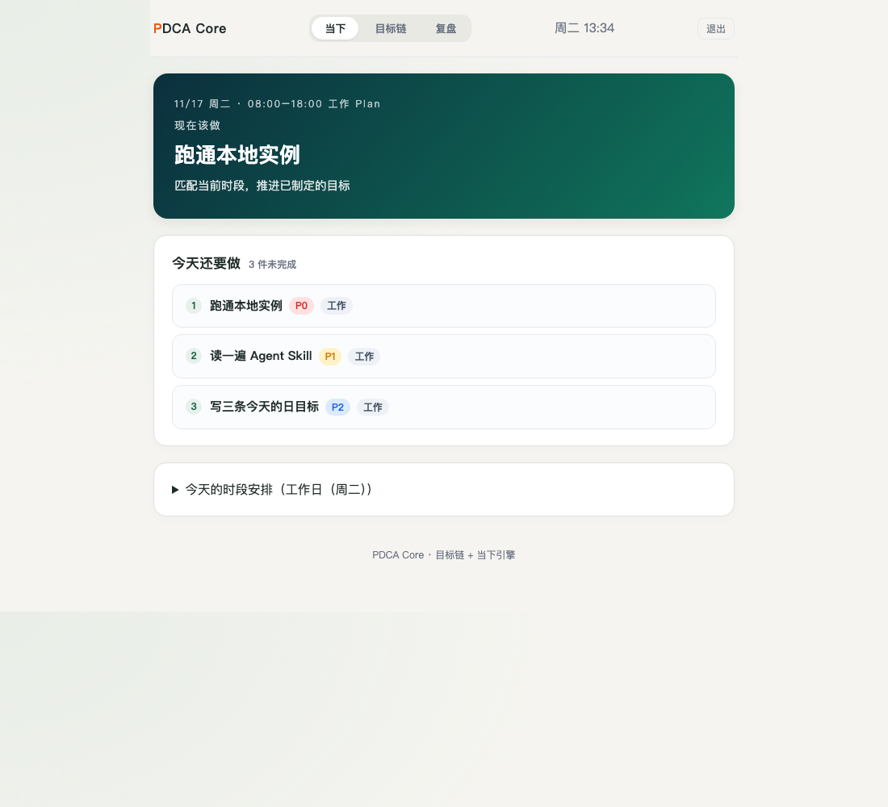
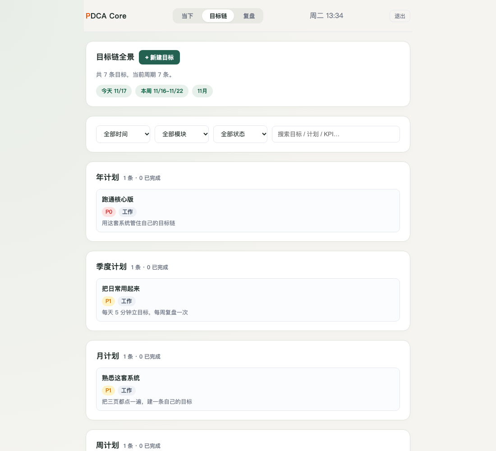
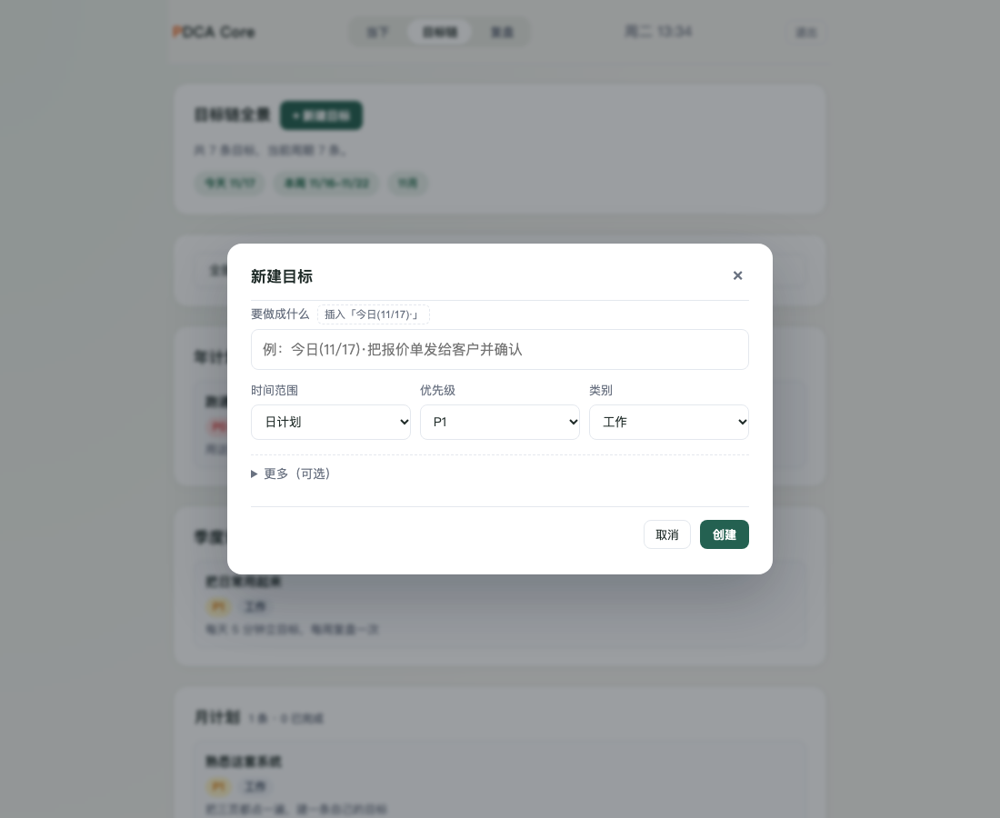
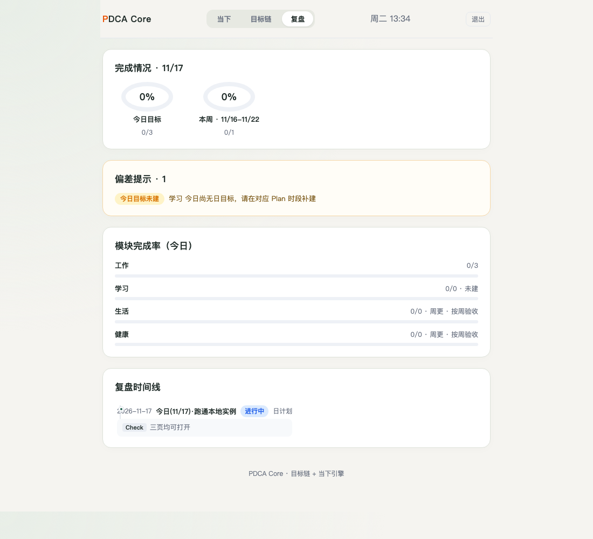
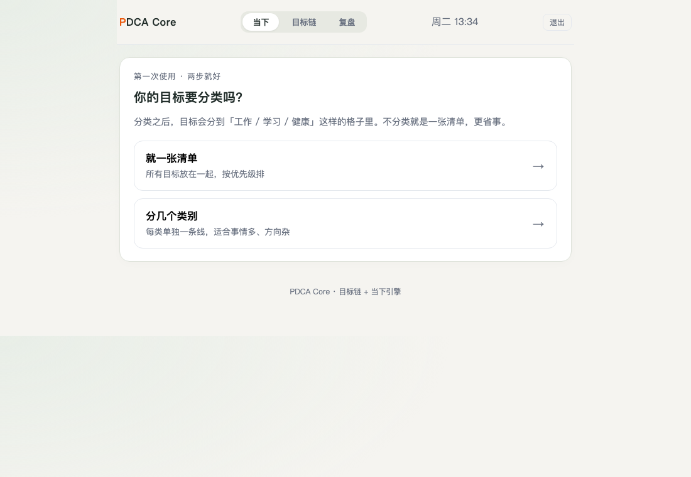

# PDCA Core

六级目标链 + 「现在该做什么」引擎 + 可配置世界观 + Agent 上岗手册。

从个人自用版 `pdca-dashboard` 抽出来的**可分发核心版**：人名、模块、作息表、校验强度全部收进 `profile/`，换一份配置就是一套属于你自己的目标管理系统。代码里不出现任何具体模块名。

> 状态：`v0.1.3`。仓库已开源：<https://github.com/lxj808624/pdca-core>，按 [AGPL-3.0-or-later](LICENSE) 使用。
>
> 公开的只有这一个仓库；个人自用版 `pdca-dashboard` 与 SDE·IP 的其他项目都不对外。
>
> 只做自托管形态：一个进程、一个 SQLite 文件、一个访问口令。此前的多租户注册版已下线，需要时从 tag `toc-archive-20261113` 取回。



<details>
<summary>目标链 / 新建目标 / 复盘 长什么样</summary>



点「+ 新建目标」用表单录入（也可 `?new=1#plan` 直达）：校验不通过时会把具体规则回显在表单顶部。



</details>

## 它是什么

- **六级目标链**：三年 → 年 → 季度 → 月 → 周 → 日，`parent_id` 串起来，向上可追溯。
- **当下引擎**：结合当前时段、目标状态与优先级，回答「现在该做什么、今天还差什么」。
- **目标详情**：单条目标的上下游链、子目标、Plan / KPI / Check / Act 备注、变更日志。
- **硬校验**：主线数量、子业务线、目标链完整性、优先级必填，规则强度由 profile 决定。
- **Agent 上岗手册**：`AGENTS.md` + `agent/skills/pdca/`，换任何 Agent 都不丢能力。

不包含：账号体系、多租户、提醒推送、习惯打卡、时间线、Docker。提醒交给使用者自己的 Agent 或系统日历。

## 30 秒跑起来

需要 **Node.js ≥ 22.13**（数据库用内置 `node:sqlite`；22.13 之前要额外开 flag，本项目不依赖 flag）。版本不够时启动自检会给中文提示。`npm test` 走 bash 脚本，Windows 上用 WSL 或 Git Bash。

```bash
npm install && npm install --prefix client
npm run build
npm start            # http://localhost:3000
```

空库自动建表，不需要预先导入。第一次打开浏览器会走两步引导：



1. **你的目标要分类吗**：选「就一张清单」= 所有目标放一起按优先级排；选「分几个类别」= 挑现成的或自己起名（最多 8 个，每个 ≤12 字）。
2. **建第一个目标**：填名称 + 时间范围（+ 类别，如果上一步分了类）。

想先看有数据的样子：`npm run seed:demo`（写 7 条按今天生成的演示目标，幂等，重跑覆盖同 id；服务在跑也能导，导完刷新页面）。

想导入自己的旧快照：`cp data/seed.example.ndjson data/seed.ndjson && npm run seed`（示例是 5 条历史目标，先改成自己的字段再导）。

不配 `PDCA_PASSCODE` 时是本地开发模式（读写全放行）；**部署到公网必须配口令 + token**。

## 三页做什么

| 页面 | 地址 | 内容 |
|---|---|---|
| 当下 | `/` | 一张 hero 说「先做这件/现在该做」，下面是今天还要做的清单；底部可展开时段安排 |
| 目标链 | `/#plan` | 按周期分组的目标全景、筛选与搜索、「+ 新建目标」、详情抽屉（编辑 / 改状态 / 删除） |
| 复盘 | `/#check` | 今日/本周完成率、偏差提示、模块完成率（多模块时）、复盘时间线 |

写入有两条通道，落的是同一个库、过的是同一套 `server/validate.js`：

- **页面表单**：登录后的同源 Cookie 会话即可写（服务端校验 `Origin` 防 CSRF），不需要手填 token。
- **Agent / 脚本**：`Authorization: Bearer $PDCA_API_TOKEN`（读、写都行，不需要 Cookie）。

```bash
curl -s -X POST http://localhost:3000/api/goals \
  -H "Authorization: Bearer $PDCA_API_TOKEN" -H 'Content-Type: application/json' \
  -d '{"name":"今日(11/17)·验收当下页","module":"工作","dimension":"日计划","priority":"P0"}'
```

目标名称必须带周期前缀（`2026年·` / `Q4·` / `11月：` / `本周(11/9-11/15)·` / `今日(11/17)·`），否则不会进入当下页。完整规则见 `agent/skills/pdca/SKILL.md §4`。

## 世界观配置（`profile/`）

`profile/default.json` 是**示例配置**：四类（工作 / 学习 / 生活 / 健康）+ 一份普通作息表。想换成自己的：

```bash
cp profile/default.json profile/local.json     # local*.json 已 gitignore，不会被提交
# 改 profile/local.json 里的模块、支柱、维度、规则、时段表
PDCA_PROFILE=$PWD/profile/local.json npm start
```

模块来源有优先级，从高到低：

1. **`meta.modules`**：使用者在浏览器首启里选过「分类」后写入的模块（一人一库，改 profile 不会覆盖它）。
2. **`profile.modules`**：没在浏览器里选过时的默认值。

所以：想让所有人默认用你这套 → 改 `profile/default.json`；只想自己用 → 用 `PDCA_PROFILE` 指向 `profile/local.json`，别动默认文件。

首启之后要改分类（Agent 或脚本）：`POST /api/setup {"modules":["工作","副业"]}`，`[]` 回单清单。已有目标时旧模块名的目标会从清单里消失，非必要别中途改。

几条关键规则（都能在 profile 里调）：

- `rules.mainlineLimit`：同一「模块 + 子模块 + 维度 + 周期」最多几条进行中主线（默认 3）。
- `rules.subLineSplit`：模块带 `subLines` 时，目标名称必须包含其中一个子业务线词。
- `modules[].cadence`：`daily` 日更 / `weekly` 周更 / `none` 只留时段不立目标。
- `schedule`：时段表。想完全不用时段表，页面「目标链 → 设置」里可以关掉时间分块（`POST /api/settings {"timeBlocks": false}`）。

## 环境变量

| 变量 | 默认 | 说明 |
|---|---|---|
| `PORT` | 3000 | 服务端口 |
| `HOST` | 127.0.0.1 | 监听地址，由 Nginx 反代对外 |
| `PDCA_DB` | `data/pdca.db` | SQLite 路径 |
| `PDCA_PROFILE` | `profile/default.json` | 世界观配置，可指向任意绝对路径 |
| `PDCA_PASSCODE` | 无 | 浏览器访问口令（30 天会话 Cookie） |
| `PDCA_API_TOKEN` | 无 | 写接口与脚本读的 Bearer token（也可写 `server/config/api.json`） |
| `PDCA_SEED` | `data/seed.ndjson` | `npm run seed` 的导入源 |
| `PDCA_CALENDAR` | 无 | 外部节假日 JSON（绝对路径），补齐内置日历未收录的年份 |

## 部署到公网（systemd + Nginx + HTTPS）

```bash
git clone https://github.com/lxj808624/pdca-core.git /srv/pdca-core && cd /srv/pdca-core
npm install && npm install --prefix client && npm run build

cp deploy/pdca-core.service /etc/systemd/system/   # 若 `which node` 不是 /usr/bin/node，改里面的 ExecStart
printf 'PORT=3000\nHOST=127.0.0.1\nPDCA_DB=/srv/pdca-core/data/pdca.db\nPDCA_PASSCODE=%s\nPDCA_API_TOKEN=%s\nTZ=Asia/Shanghai\n' \
  "$(openssl rand -hex 12)" "$(openssl rand -hex 16)" > /etc/pdca-core.env
chmod 600 /etc/pdca-core.env

systemctl daemon-reload && systemctl enable --now pdca-core

cp deploy/nginx-site.conf /etc/nginx/sites-available/pdca-core   # 改域名与端口
ln -sf /etc/nginx/sites-available/pdca-core /etc/nginx/sites-enabled/pdca-core
nginx -t && systemctl reload nginx
certbot --nginx -d <你的域名> --non-interactive --agree-tos -m <邮箱>
```

日常更新：`bash deploy/deploy.sh`（`git pull` → 装依赖 → 构建 → 重启 → `/api/health` 重试 20 次；带 `--seed` 才会导入快照）。

Windows / macOS 本机试玩不需要守护进程，直接 `npm start`（数据与端口都在本机，别对外暴露）。

## 备份 / 恢复

```bash
bash deploy/backup.sh                 # → backups/pdca-<时间>.db + profile-<时间>/ + goals-<时间>.ndjson
# crontab: 10 3 * * * cd /srv/pdca-core && bash deploy/backup.sh >> /var/log/pdca-backup.log 2>&1

bash deploy/restore.sh backups/pdca-20261117-031000.db   # 覆盖前会自动另存 backups/pre-restore-<时间>/
```

备份前会先 `PRAGMA wal_checkpoint(TRUNCATE)` 把 WAL 合并回主文件，避免拷到一半的库。默认保留最近 10 份。

## 日历维护

`server/calendar.js` 内置 2026、2027 的法定节假日与调休。国务院发布次年安排后补录，或者直接写一份 JSON 用 `PDCA_CALENDAR` 指向它（格式见文件顶部注释）。未收录的年份会在当下页提示「按周末近似判断」。

## 自检与排障

```bash
npm test        # scripts/smoke.sh：临时库起服务，23 项断言（鉴权/模块/校验/当下/复盘/备份）
```

| 现象 | 原因 / 处理 |
|---|---|
| 启动就退出，提示 Node 版本 | 低于 22.13（或 23.0–23.3），升级到 22 LTS 最新 / 23.4+ / 24+ |
| 打开页面 401 / 一直跳登录 | 没登录或口令配错；`/login` 输口令，或删掉 `PDCA_PASSCODE` 本地开发 |
| 页面写入 401 | Cookie 过期（重新登录）；脚本写入要带 Bearer token |
| 页面写入 403 | 跨站请求被拒（`Origin` 与站点不一致），从本站页面操作 |
| 日目标不出现在当下页 | 名称没带周期前缀，或模块不在值域（读 `/api/profile`） |
| 导了 demo 但看不见 | 演示数据按「你的模块」生成；先看首启是否分过类，必要时 `?force=true` 重导 |
| 「前端未构建」 | 没跑 `npm run build` 就 `npm start` |

## 目录

```
server/      Fastify API + node:sqlite（engine: now.js / check.js / validate.js / usermodules.js）
client/      React 前端（三页 + 详情抽屉 + 录入表单）
profile/     世界观配置（default.json 是示例；local*.json 自用、不入库）
agent/       Agent 上岗手册（AGENTS.md 指向 skills/pdca/）
deploy/      systemd / Nginx / 部署 / 备份 / 恢复脚本
scripts/     冒烟测试（smoke.sh + smoke.mjs）
docs/        SCOPE（裁剪与里程碑）、TODO、截图
```

## 给 Agent 用

这是设计上的主用法：**人跟 Agent 说话，Agent 通过 API 写目标和回读当下页；网页负责展示与兜底手填。**

把仓库交给任何 Agent，给它三样东西：服务地址、`PDCA_API_TOKEN`、一句「先读 `AGENTS.md` 和 `agent/skills/pdca/SKILL.md`」。它就能自己完成：

```bash
curl -s -H "Authorization: Bearer $PDCA_API_TOKEN" http://localhost:3000/api/profile   # 先读世界观
curl -s -H "Authorization: Bearer $PDCA_API_TOKEN" http://localhost:3000/api/now       # 现在该做什么
curl -s -X POST http://localhost:3000/api/goals -H "Authorization: Bearer $PDCA_API_TOKEN" \
  -H 'Content-Type: application/json' \
  -d '{"name":"今日(11/17)·把核心版跑起来","module":"工作","dimension":"日计划","priority":"P0"}'
```

命名规范、字段、错误码在 `agent/skills/pdca/SKILL.md`；完整流程在 `flows.md`；API 速查在 `reference.md`。规则由后端硬校验，不靠 Agent 自觉。

## 授权

**AGPL-3.0-or-later**，见 [LICENSE](LICENSE)。简单说：自托管、修改、分发都可以；如果改成网络服务对外提供，要把改后的源码一并开放（AGPL 第 13 条）。

任何人都可以直接克隆使用；改了代码并作为网络服务对外提供时，按 AGPL 第 13 条开放对应源码。后续项目默认都用 AGPL。
